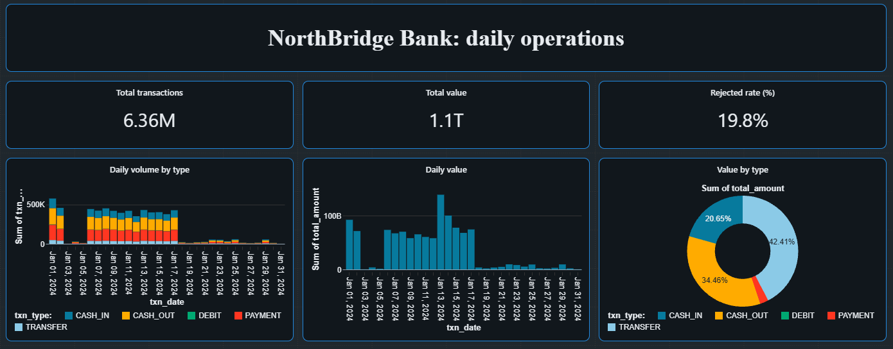
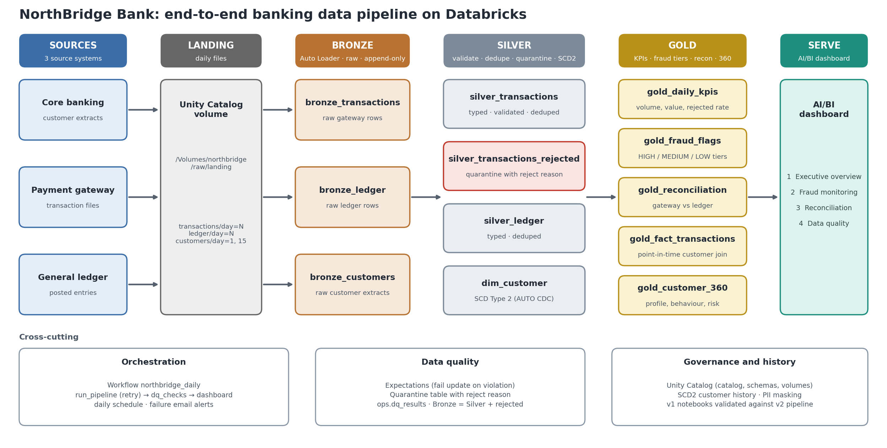
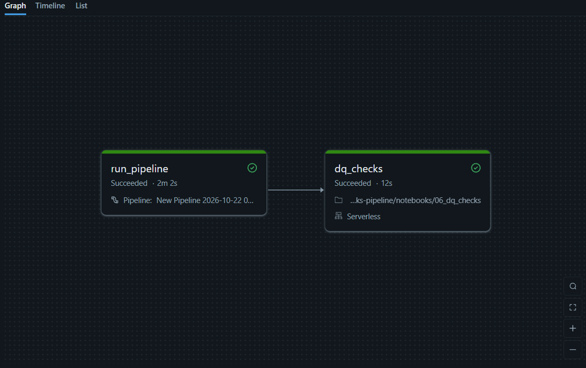

# NorthBridge Bank: End-to-End Banking Data Pipeline on Databricks

A medallion-architecture data platform for a fictional retail bank, built on **Databricks Free Edition** with Unity Catalog, Auto Loader, Delta Lake, Lakeflow Declarative Pipelines and Workflows. It ingests messy data from three source systems, validates and quarantines bad records, tracks customer history, flags suspicious transactions, reconciles the payment gateway against the general ledger, and serves the results to a dashboard.

> **Walkthrough video:** `<add link>` (4 minutes)



---

## Problem

NorthBridge Bank's data lives in separate systems that do not agree with each other:

| Source | Content |
|---|---|
| Core banking | Customer and account master (daily extract) |
| Payment gateway | Transaction files dropped through the day |
| General ledger | End-of-day posted entries |

This caused five problems: fraud reviewed a day late from manually merged spreadsheets, frequent unexplained reconciliation failures, duplicate and malformed records leaking into reports, no single view of volume and risk, and customer PII sitting in raw files.

**Goal:** an automated, reliable and auditable pipeline that produces trusted tables for analysts and the fraud and finance teams.

---

## Architecture



```
Raw files (Unity Catalog volume: landing)
   |  Auto Loader
   v
BRONZE   raw, append-only, + _ingest_ts, _source_file
   |  type-cast, validate, de-duplicate, quarantine bad rows
   v
SILVER   transactions, ledger, rejected rows, dim_customer (SCD Type 2)
   |  model, aggregate, flag, reconcile
   v
GOLD     daily_kpis, fraud_flags, reconciliation, fact_transactions, customer_360
   |
   v
AI/BI dashboard        (orchestrated daily by a Workflow with retries and failure alerts)
```

The pipeline was built twice on purpose:

- **v1: notebooks** (`notebooks/00` to `04`) in the `bronze`, `silver` and `gold` schemas. This is where each pattern was built and tested step by step.
- **v2: Lakeflow Declarative Pipeline** (`pipelines/northbridge_pipeline.sql`) in the `lakeflow` schema. The same logic, rebuilt declaratively with expectations and an AUTO CDC flow for the SCD2 dimension.

`notebooks/05_validate_pipeline` proves that v2 reproduces v1: row counts and transaction IDs match on every table.

---

## Data

| Dataset | Source |
|---|---|
| Transactions | PaySim synthetic fraud dataset (Kaggle), about 6.36 million rows over 31 days |
| Customers | Generated from a hash of the customer ID: a day-1 extract of all 6.35 million customers and a day-15 change extract (about 2%, changed city and status) |
| Ledger | Derived from transactions with planted defects: about 0.5% of rows dropped, about 0.3% with changed amounts |
| Gateway defects | About 0.2% of rows re-sent as duplicates, plus 10 null-ID and 10 negative-amount rows |

One PaySim step is one hour, so step 1 maps to 2024-01-01 00:00. Raw files are not committed; `notebooks/00_prepare_data` regenerates them.

---

## Results

### Data quality
Every Bronze row is accounted for: **Bronze rows = Silver rows + rejected rows**, checked per day on all 31 days. Rejected rows are kept with the rule they broke (`NULL_TXN_ID`, `INVALID_AMOUNT`, `DUPLICATE_TXN_ID`, and so on) instead of being deleted.

- Silver holds **6,362,604** clean transactions with no duplicate IDs.
- Example (days 1 to 7): 1,933,999 Bronze rows became 1,930,180 Silver rows plus 3,819 rejected (3,799 duplicates, 10 null IDs, 10 negative amounts).
- Loads are idempotent: re-running any day, in any order, does not change totals.
- Automated checks write to `ops.dq_results`, and the Workflow fails if a critical check fails.

### Reconciliation (gateway vs ledger)
| Status | Records | Share of transactions |
|---|---|---|
| Missing in ledger | 31,672 | 0.498% |
| Amount mismatch | 19,079 | 0.300% |
| Missing in gateway | 16 | under 0.001% |

These match the planted defect rates. The 16 "missing in gateway" rows are real zero-amount PaySim transactions that Silver rejects (`amount` must be greater than 0) but the ledger keeps.

### Fraud rules
The base fraud rate is **0.129%** (8,197 fraud-labelled transactions in Silver).

| Version | Alerts | Precision | Recall | Lift over base rate |
|---|---|---|---|---|
| v1: any of three rules | 2,143,242 | 0.38% | 99.98% | 3x |
| v2: top tier only | 163,253 | 2.09% | 41.7% | 16x |
| v2: top two tiers | 325,240 | 1.59% | 63.2% | 12x |
| v2: all tiers | 1,188,074 | 0.67% | 97.7% | 5x |

v1 caught nearly all fraud but flagged a third of all transactions. Scoring each rule showed that the high-value and mule rules added little signal (the mule rule was worse than random), so v2 keeps only drained transfers and cash-outs and ranks them into **HIGH / MEDIUM / LOW** tiers by transaction size and whether the destination account was empty. A reviewer works the queue from the top, and the full list still keeps 97.7% recall. Rules alone top out near 2% precision on this dataset, so a trained model is the natural next step.

### Customer history (SCD Type 2)
`dim_customer` holds 6,481,052 rows: 6,353,307 current versions and 127,745 closed ones. Each transaction in `gold.fact_transactions` is joined to the customer version that was valid **at the time of the transaction** (point-in-time join), not the current one.

---

## Orchestration

A daily Workflow (`northbridge_daily`) runs the pipeline, then the data-quality notebook. It has retries, a schedule and failure email alerts.



---

## Design decisions

| Decision | Reason |
|---|---|
| Bronze stays raw | Lets any layer be rebuilt by replaying files |
| Quarantine table with a reason, duplicates included | Nothing disappears silently, and the row-count equation balances |
| `try_cast` instead of `cast` | Serverless compute is strict; a bad value would fail the whole job |
| `DECIMAL(18,2)` for money | Exact comparisons in reconciliation |
| SCD2 changes applied only if newer than the current version | Replays and late reruns cannot corrupt history |
| Point-in-time join in the fact table | Answers "where did the customer live when this happened?" |
| Tiered fraud queue instead of one rule | Matches how a review team has to work with limited capacity |
| Zero-amount postings | `[choose one: quarantined as invalid, or allowed through]`: write your decision and reason here |

---

## Lessons learned

- **A row-count check cannot catch bad IDs.** In testing, `lpad` silently truncated generated transaction IDs to 9 characters, so 1.93 million rows had only 887,432 distinct IDs. The counts matched; the IDs were wrong. Comparing total to distinct caught it, and the fix was a wider pad plus a uniqueness check that now runs automatically.
- **Measure rules before trusting them.** A rule that sounds suspicious ("many senders into one account") can be worse than random on real data.
- **Free Edition shapes the design:** serverless only, a daily compute quota, one active pipeline per type and at most 5 concurrent job tasks. Schedules are kept paused except while demonstrating.

---

## Repository structure

```
northbridge-databricks-pipeline/
├── README.md
├── docs/
│   ├── architecture.png
│   ├── scd2-note.md
│   └── images/               dashboard and workflow screenshots
├── notebooks/
│   ├── 00_prepare_data       generate day files, ledger, customers
│   ├── 01_bronze_ingest      Auto Loader into Bronze
│   ├── 02_silver_transform   quality rules, quarantine, dedupe
│   ├── 03_silver_scd2        SCD2 dimension with MERGE
│   ├── 04_gold_models        Gold tables and fraud scoring
│   ├── 05_validate_pipeline  v1 vs v2 comparison
│   └── 06_dq_checks          automated checks for the Workflow
├── pipelines/
│   └── northbridge_pipeline.sql
└── sql/
    ├── 00_setup.sql
    └── dashboard_queries.sql
```

---

## How to run

1. Create a Databricks Free Edition workspace and clone this repo into a Git folder.
2. Run `sql/00_setup.sql` to create the catalog, schemas and volumes. Also run `CREATE SCHEMA IF NOT EXISTS northbridge.lakeflow;`.
3. Download PaySim from Kaggle, upload it to `/Volumes/northbridge/raw/staging/`, and run `notebooks/00_prepare_data`.
4. Land day folders into `/Volumes/northbridge/raw/landing/` (functions in `01_bronze_ingest`).
5. Create a pipeline from `pipelines/northbridge_pipeline.sql` (catalog `northbridge`, schema `lakeflow`, triggered mode) and run it.
6. Create the `northbridge_daily` Workflow with the pipeline task, then `06_dq_checks`.

---

## What I would add in production

- CI/CD with automated tests on pull requests (Databricks Asset Bundles)
- Parameterised catalog, schema and paths instead of hard-coded volume paths
- Table optimisation (liquid clustering) and cost monitoring
- Alerting integrations (Slack or PagerDuty) and data lineage review
- A trained fraud model (for example gradient-boosted trees) compared against the rule tiers
- Real access groups for PII instead of a masked view

---

## Author

**K Siddharth Pattnaik**, B.Tech CSE (Business Systems), VIT-AP University

- GitHub: [pattnaiksiddharth](https://github.com/pattnaiksiddharth)
- LinkedIn: [k-siddharth-pattnaik](https://www.linkedin.com/in/k-siddharth-pattnaik-4844443ab)